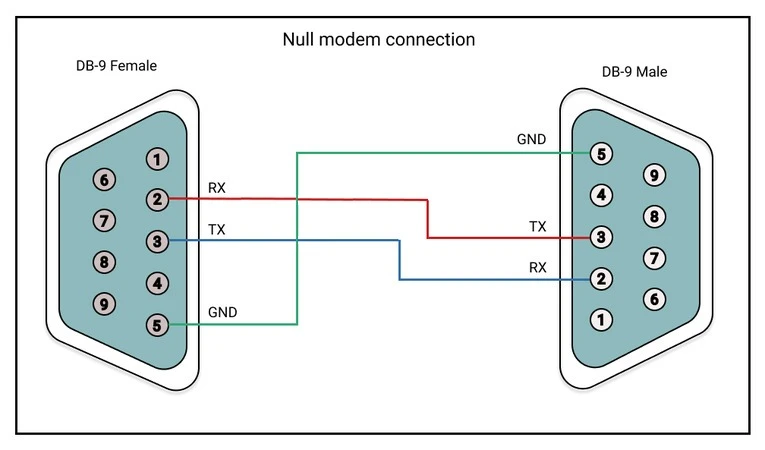
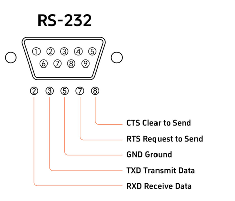

# [RS232](readme.md)

## Description

Le standard RS-232 (parfois appelé EIA-232 ou TIA-232) est une norme de communication série asynchrone point à point créée en 1960.

## Broches minimales

Trois fils suffisent pour une liaison de base :

- Broche 2 : Réception (RX) ou Émission selon le sens.
- Broche 3 : Émission (TX) ou Réception selon le sens.
- Conçu pour de courtes distances (généralement jusqu'à 15 mètres) et des débits standards allant de 1200 à 115 200 bps (jusqu'à 1 Mbps dans certaines configurations)

