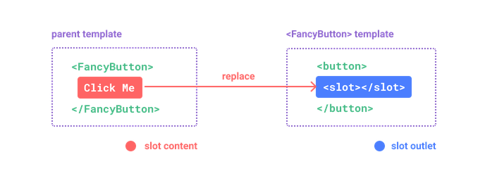
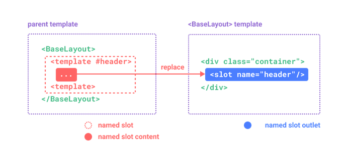

# [Composants](readme.md)

## Passer des variables parent vers enfant

::: code-group

```vue [Parent]
<script setup lang="ts">
const name = ref('bob')
</script>
<template>
    <template label="label" :name="name" />
</template>
```

```vue [enfant]
<script setup lang="ts">
defineProps({
    label: String,
    name: String,
})
</script>

<template>

    {{ label }} 
</template>
```

## Passer des variables enfant vers parent

:::

```vue [Parent]
<script setup lang="ts">
const reload = () => {
    // do
} 
</script>
<template>
    <template label="label" :name="name" @check="reload" >
</template>
```

```vue [enfant]
<script setup lang="ts">
defineEmits(['check', 'uncheck'])

const onChange() = (event) => {
    emits('check',12)
} 
</script>

<template>
    <input type="checkbox" @change=(onChange) />
</template>
```

:::

## Slot

:::

```vue [Parent]

<template>
    <FancyButton>
        Click me! <!-- slot content -->
    </FancyButton>
</template>
```

```vue [enfant]


<template>
    <button class="fancy-btn">
        <slot></slot> <!-- slot outlet -->
    </button>
</template>
```

:::



## Named Slot

:::

```vue [Parent]

<template>
    <BaseLayout>
        <template v-slot:header>
            <!-- content for the header slot -->
        </template>
        <template v-slot:main>
            <!-- content for the main slot -->
        </template>
        <template v-slot:footer>
            <!-- content for the footer slot -->
        </template>
    </BaseLayout>
</template>
```

```vue [enfant]


<template>
    <div class="container">
        <header>
            <slot name="header"></slot>
        </header>
        <main>
            <slot></slot>
        </main>
        <footer>
            <slot name="footer"></slot>
        </footer>
    </div>
</template>
```

:::




:::

```vue [Parent]

<template>
    <BaseLayout>
        <template v-slot:header>
            <!-- content for the header slot -->
        </template>
        <template v-slot:main>
            <!-- content for the main slot -->
        </template>
        <template v-slot:footer>
            <!-- content for the footer slot -->
        </template>
    </BaseLayout>
</template>
```

```vue [enfant]

<template>
  <div class="card">
    <div v-if="$slots.header" class="card-header">
      <slot name="header" />
    </div>
    
    <div v-if="$slots.default" class="card-content">
      <slot />
    </div>
    
    <div v-if="$slots.footer" class="card-footer">
      <slot name="footer" />
    </div>
  </div>
</template>
```

:::